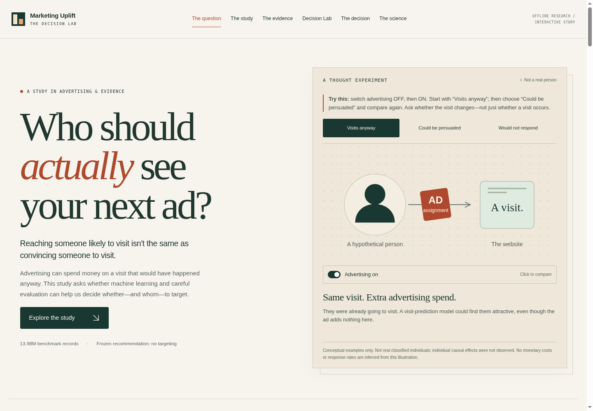
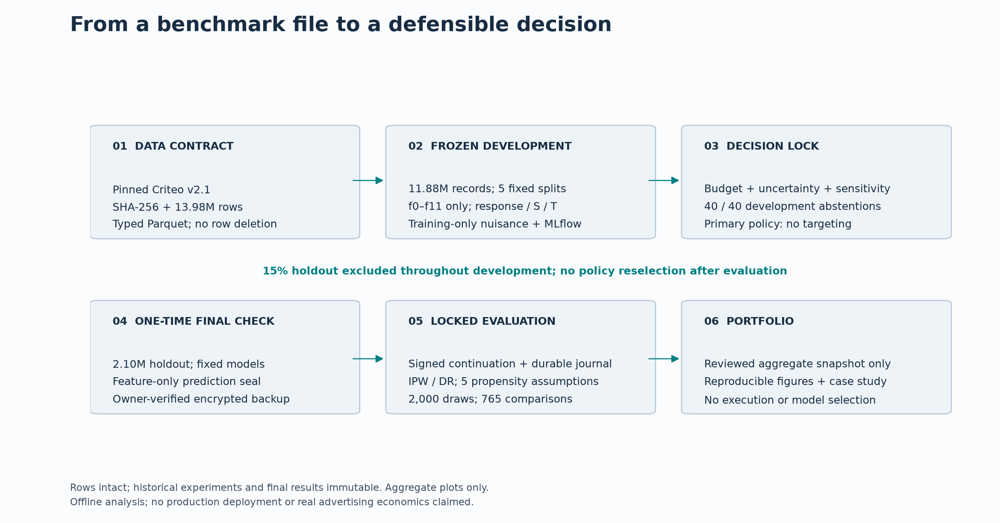
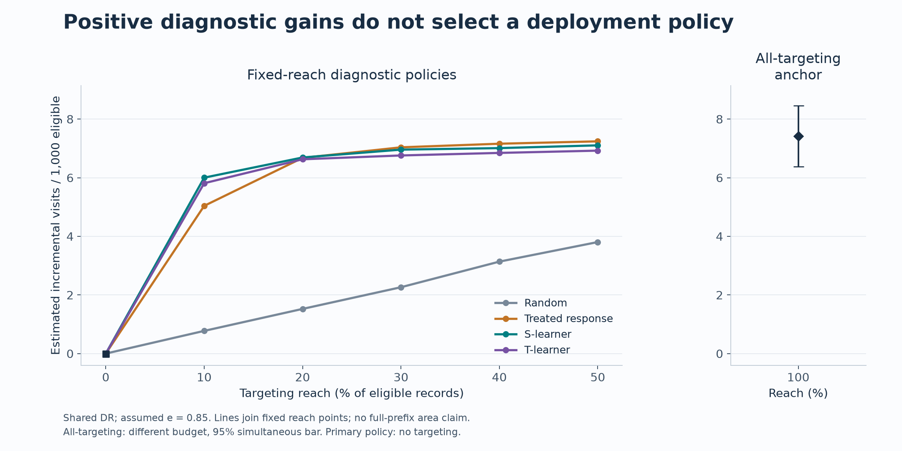
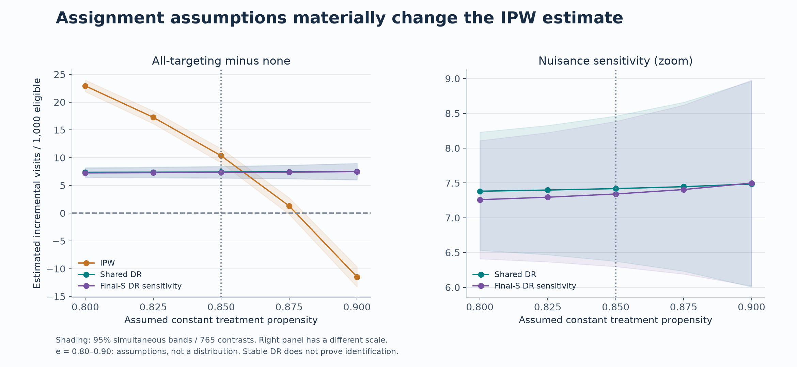
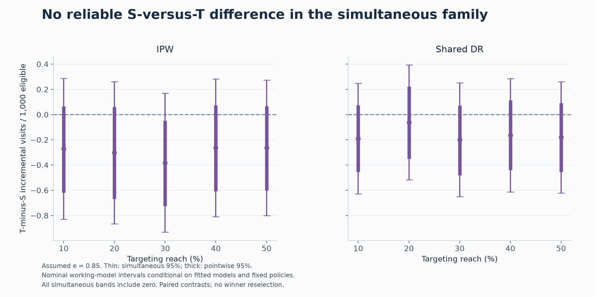

# Marketing Uplift & Causal Decision Engine

Marketing teams need to identify visits advertising might add—not just people
likely to visit anyway. This offline study compares random targeting, treated-response,
S-learner and T-learner policies on the corrected **13.98 million-record Criteo
benchmark**, using frozen development splits and one completed holdout evaluation.
Its precommitted stress-test rule retained no targeting; the React Decision Lab
explains that evidence and its limits using approved aggregates only.

**Final recommendation: retain the frozen no-targeting policy.** Positive secondary
targeting diagnostics do not establish an optimal strategy or authorize replacing
the recommendation after seeing the final holdout. Zero gain relative to no
targeting is an identity—not proof that advertising is ineffective or abstention optimal.

> Phase 9's one-time evaluation is completed and closed. These materials present
> frozen aggregate results without rerunning the evaluation or reselecting a policy.
> This is an offline portfolio study, not a deployed advertising system.

[Case study](docs/CASE_STUDY.md) · [Interview guide](docs/INTERVIEW_GUIDE.md) ·
[Model card](docs/MODEL_CARD.md) · [Architecture](docs/ARCHITECTURE.md) ·
[Aggregate results and figure guide](reports/portfolio/README.md)

[Local completion and verification evidence](reports/portfolio/completion.md)

## Decision Lab — React website source



A local preview of the existing editorial website; no live deployment is claimed.
Criteo-derived presentation assets retain [CC BY-NC-SA 4.0 attribution](web/NOTICE.md);
application software remains MIT.
Explore six chapters: the business question, real study, saved comparisons,
hypothetical budget lab, original decision and expandable methodology.
The rule abstained in all 40 configurations: five zero-value gates, five infeasible
initial reaches, and 120 first-tranche candidate stops in the other 30, all bound
by assumed e=.90 unnormalized IPW. Some sensitivity is mechanical; this is not
proof that advertising is ineffective or abstention universally optimal.

**Technology:** Python, LightGBM and MLflow for the frozen research;
React, TypeScript and Vite for the aggregate-only website.

```sh
cd web
npm ci                 # Node.js 24
npm run dev
```

[PR #16](https://github.com/Sjaisw12/marketing-uplift-engine/pull/16) ·
[Scientific methodology and reconciliation](docs/SCIENTIFIC_RECONCILIATION.md) ·
[Frontend README](web/README.md) · [Vercel launch checklist](web/DEPLOYMENT.md)

**Live URL:** not configured. Add the verified owner-approved Vercel URL here only
after authorized deployment; no invented URL or automatic deployment is configured.
<!-- Verified live Vercel URL goes here only after owner approval and live checks. -->

The React `web/` tree is the intended public-site source. The `app/` Streamlit
implementation below is a separate local development dashboard, not the deployed
website or a production model service. Source publication in PR #16 does not
constitute hosting approval.

## Local Streamlit development dashboard

Phase 11 adds an aggregate-only Streamlit dashboard: business overview, fixed-reach
comparisons, saved IPW/DR sensitivity, hypothetical budget arithmetic and paired
model explanations. The frozen primary decision stays **no targeting**. Controls
never train, score, reopen outcomes, interpolate propensity scenarios or select a new policy.

For a minimal Python 3.12 environment, from the repository root:

```sh
uv venv --python 3.12 .venv-dashboard
uv pip sync --python .venv-dashboard/bin/python app/requirements.txt
.venv-dashboard/bin/python -m streamlit run app/streamlit_app.py --server.address=127.0.0.1
```

Open `http://localhost:8501`. In an existing research development environment,
`make dashboard` launches the same app. The minimal deployment installs only the
37 pinned Streamlit runtime dependencies; it needs no models, data download,
credentials or historical analytical environment.

The budget page scales saved benchmark rates using hypothetical population,
assignment cost and visit value. It is **not validated ROI, deployment guidance or
a new causal estimate**. Scaled saved intervals do not cover transport uncertainty.

[Local launch and Community Cloud checklist](docs/DASHBOARD.md).
Source is under review in PR #16; no public hosting or live-demo link is claimed.
Hosting deployment requires separate owner approval.



## What was built

| Layer | Implementation |
|---|---|
| Data engineering | Pinned revision and SHA-256; full-file contract; DuckDB/Parquet; preserved source-row mapping |
| Experimental design | Sealed 15% holdout; five frozen development re-splits; leakage and artifact-integrity tests |
| Machine learning | LightGBM treated-response, S-learner and T-learner; reproducible random targeting; MLflow provenance |
| Evaluation | Equal-reach policies at 10–50%; none/all anchors; IPW, shared DR and nuisance sensitivity |
| Decision support | Hypothetical budgets/costs/visit values; conservative marginal-benefit rule allowed to abstain |
| Final evaluation | Development-only refits; locked policies; independent prediction-backup restore; signed gates and one-time journal |
| Presentation | Aggregate-only reproducible figures, uncertainty tables, case study and model card |

## Data and leakage prevention

[Criteo's corrected release](https://huggingface.co/datasets/criteo/criteo-uplift)
contains 13,979,592 rows, 12 anonymized numeric features (`f0`–`f11`) and four binary
indicators: `treatment`, `visit`, `conversion`, `exposure`. **Visit** is the outcome;
conversion is outside this study. Exactly `f0`–`f11` are user predictors. The S-learner
receives treatment separately as an intervention indicator, not an exported user feature.
Exposure is post-assignment and never enters predictors.

The archive is exactly 311,422,618 bytes at revision
`82811785048bb633de2d55c02bab4e57066e6423`; verified SHA-256:

```text
2716e1bf0fd157a93b5bf86924d9088419dfbac2022c6cd90030220634f616dc
```

Validation and ingestion preserve all rows: no silent dropping, deduplication or
imputation. Source-row ordinals establish alignment, not customer identity.
The frozen development pool contains **11,882,653 records**; the final holdout
contains **2,096,939**. Joint treatment × visit stratification was predeclared.
Five overlapping 80/20 development re-splits assess stability; they are not five
independent experiments. The [data audit](reports/data_audit.md) documents repeated
feature vectors, concentrated distributions and covariate balance.

## Models and evaluation

The treated-response model estimates visit probability among assigned records.
The S-learner scores `p(visit | X, T=1) − p(visit | X, T=0)` using one model; the
T-learner subtracts separate arm-model predictions. An individual causal response
is never observed. All model recipes were frozen before final evaluation, with
200 LightGBM rounds, 31 leaves, learning rate 0.05 and two training threads.
Training-only nuisance folds supply the shared DR evaluator; no holdout outcome
influenced training, rankings, reach, spending or model selection.

For policy π, the target is visit value `V(π)` and incremental gain
`Δ(π) = V(π) − V(no targeting)`. Estimates below are **visits per 1,000 eligible
records**, not per targeted user. Assignment effects differ from effects of actual
exposure: no exposure conditioning or treatment-on-the-treated claims are made.

**Constant propensity e=0.85 is a reference assumption, not a verified assignment
probability.** IPW and DR are reported separately across e=0.80, 0.825, 0.85, 0.875
and 0.90. Causal interpretation additionally requires consistency, positivity,
exchangeability, no interference and suitable propensity/outcome-model correctness
in the released population. Unknown experiment IDs, varying assignment probabilities
and non-uniform privacy subsampling may violate those conditions. DR does not
automatically remove those limitations.

## Measured final results

Observed holdout rates are **4.8543% treatment** (86,523 / 1,782,398) and
**3.8202% control** (12,016 / 314,541): a **descriptive 1.0341 percentage-point
difference**, not an unqualified causal effect.



At assumed e=0.85, shared-DR secondary diagnostics are:

| Reach | Random | Treated response | S-learner | T-learner |
|---|---:|---:|---:|---:|
| 10% | 0.774 | 5.040 | 6.002 | 5.812 |
| 20% | 1.524 | 6.677 | 6.690 | 6.629 |
| 30% | 2.264 | 7.037 | 6.958 | 6.759 |
| 40% | 3.138 | 7.160 | 7.010 | 6.846 |
| 50% | 3.805 | 7.241 | 7.104 | 6.924 |

Treated-response is numerically larger than S and T at 30%, 40% and 50% reach.
All nine saved simultaneous pairwise intervals among those three rankings at those
reaches include zero under shared DR, assumed e=.85 and the primary IID working model.
This establishes neither superiority nor equivalence, and chooses no new policy.
These point estimates are assumption-dependent diagnostics, not a leaderboard for
choosing the final policy. The all-targeting DR anchor is **7.419** visits per
1,000 eligible, with nominal pointwise 95% interval **[6.789, 8.048]** and
simultaneous interval **[6.376, 8.462]**. All-targeting has a different budget from
fixed-reach targeting. No-targeting has exactly zero incremental gain relative to itself.



The all-targeting IPW estimate changes from **22.926** at assumed e=0.80 to
**−11.456** at e=0.90. Shared DR ranges **7.382–7.486**, with final-S DR reported
as a separate nuisance sensitivity. Relative stability of one evaluator does not
verify its models or identification assumptions. With a fixed policy and records,
unnormalized IPW is `A/e − B/(1−e)` for nonnegative A and B: increasing assumed e
mechanically decreases it. This is reweighting sensitivity, not observed effect
variation or a calibrated probability distribution.

At assumed e=.85, both all-targeting evaluators average over the same complete
2,096,939-record holdout: IPW **10.341310853**, shared DR **7.419188765**, and DR minus
IPW **−2.922122088** visits per 1,000 eligible. The difference is exactly the
nuisance-prediction augmentation, not a required equality or independent evidence
of a bug. Factual calibration cannot establish counterfactual correctness or causal
identification. See [scientific reconciliation](docs/SCIENTIFIC_RECONCILIATION.md).



All ten simultaneous S-versus-T intervals at reference e=0.85 (five reaches ×
IPW/shared DR) contain zero. This statement uses **paired contrasts**, not overlap
between two separate model intervals. No winner is reselected.

Uncertainty uses **2,000 paired Gaussian-multiplier draws** and the predeclared
**765-contrast simultaneous family**. Pointwise intervals are separate. Both are
nominal working-model intervals conditional on fitted models and fixed policies,
not exact randomization intervals or ordinary row-bootstrap intervals. The mandatory
treatment × visit-stratified sensitivity conditions on observed stratum counts;
it does not replace the primary IID working model. Full intervals for every policy,
propensity and nuisance scenario are in the [aggregate figure guide](reports/portfolio/README.md).

## Why retain no targeting?

All **40 development scenario/split configurations** abstained. Five failed the
explicit zero-value gate; five had no feasible initial reach. In the remaining
30 configurations, **all 120 candidate ranking records stopped at the first 10%
tranche**, with **unnormalized IPW at assumed e=0.90** binding every first-tranche
lower net-value bound. Insufficient event support was not the binding reason.
The negative first-tranche IPW point estimates already blocked those candidates.
This reflects the prespecified stress-test rule, not proof of advertising
ineffectiveness, universal abstention optimality or a prescription for another business.
No scenario-removal selection exercise was performed.
Phase 9 locked that recommendation before holdout outcomes.

Positive final diagnostics answer a narrower question under stated assumptions.
They neither establish optimality across policies/costs nor justify undoing that
lock. Costs, budgets and visit values are hypothetical; **no real revenue, ROI,
cost savings or advertiser-wide causal improvement was measured**.

## Reproduce the presentation safely

Use Python 3.11/3.12 and [uv 0.12.23](https://github.com/astral-sh/uv/releases/tag/0.12.23):

```sh
uv sync --locked
make portfolio
uv run --locked pytest tests/test_portfolio.py -q
make check
```

`make portfolio` reads only the checksum-pinned aggregate snapshot. It does not
download data, load models, train, rescore, resample or execute Stage B. Six figures
are emitted as PNG/SVG plus a complete aggregate CSV and figure hash manifest.
[Reproduction and disclosure notes](docs/PORTFOLIO_REVIEW.md) explain exactly what
is reproducible without private artifacts. **Do not rerun the final evaluation.**

Historical pipeline commands and protocols remain available in the source and
[phase checklist](docs/PHASES.md); they are not a portfolio reproduction recipe.
The existing one-time journal is completed. Fresh Cloud tasks must not assume
datasets, fitted models or private checkpoints persist.

## Scope, rights and next evidence

This work demonstrates reproducible data science, tabular modeling, off-policy
evaluation and honest decision reporting. It does not validate individual causal
effects, longitudinal stability, customer-level independence or production deployment.
A future study would need experiment-specific assignment probabilities, sampling
information, dependence identifiers and real economics. A new policy would require
fresh prospective evidence, not another look at this holdout.

The Phase 10 case study describes its original static portfolio scope. Phase 11
adds the dashboard described above; no live deployment or recorded demo is claimed.
See the [case study](docs/CASE_STUDY.md) for scientific findings and limitations.

**Attribution:** Criteo AI Lab; Diemert, Betlei, Renaudin and Amini (2018),
*A Large Scale Benchmark for Uplift Modeling*, AdKDD & TargetAd.
[Official dataset notes](https://ailab.criteo.com/criteo-uplift-prediction-dataset/) ·
[Pinned source](https://huggingface.co/datasets/criteo/criteo-uplift/tree/82811785048bb633de2d55c02bab4e57066e6423).
Software retains the repository MIT license; dataset-derived portfolio assets retain
[CC BY-NC-SA 4.0 attribution and restrictions](reports/portfolio/LICENSE.md).

The local Phase 11 UI redesign presents **Marketing Uplift | Decision Intelligence**:
a navy-and-cobalt executive overview, policy diagnostics, sensitivity analysis,
hypothetical budget studio and visual methodology. See the [dashboard guide](docs/DASHBOARD.md)
for Python 3.12 launch and review-bundle instructions. This presentation update
preserves the approved aggregate snapshot and frozen no-targeting recommendation;
public deployment remains a separate owner decision.

## Post-hoc development proposals — not executed

[Development exploration feasibility](docs/DEVELOPMENT_EXPLORATION_FEASIBILITY.md)
and [arm-balance diagnostic feasibility](docs/ARM_BALANCE_FEASIBILITY.md) describe
possible development-only follow-ups. They report no alternative recommendation
or new diagnostic finding, require separate approval and cannot replace the
original frozen result or reopen the completed holdout.

## Authorship and AI assistance

Created and directed by **Sanyam Jaiswal**. OpenAI Codex assisted with code,
tests, documentation and presentation implementation. The owner reviewed the
scientific scope, signed execution approvals, independently restored backups and
reviewed the results; this acknowledgement does not imply a human-authored
implementation from scratch or independent validation by an AI tool. Methodological
limitations and verification evidence are documented rather than inferred from
the use of an assistant.
