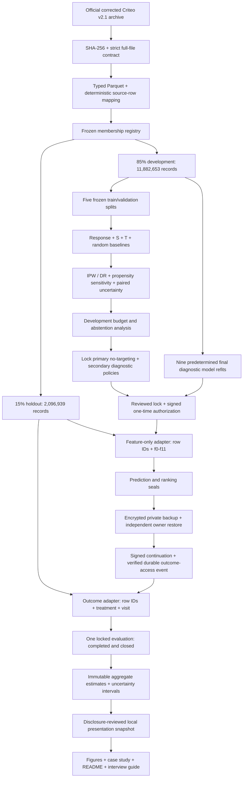

# Architecture and workflow

The arrows describe the **completed historical workflow**, not commands to execute
again. The outcome interface has already been consumed. Presentation has no edge
back into models, data, the coordinator or policy selection.

## Components and boundaries

| Component | Responsibility | Boundary |
|---|---|---|
| `src/marketing_uplift/` | Acquisition, contract, ingestion, development analysis and statistical kernels | Historical recipes/results unchanged |
| DuckDB / Parquet / Polars | Bounded scans, joins and typed analytical storage | No silent row removal; mapping preserved |
| LightGBM | Fixed response, S/T outcome models and training-only nuisances | Predictors f0–f11; S intervention separate |
| Local MLflow | Configurations, fit membership, versions and artifact provenance | Private; not redistributed |
| `src/stage_b_continuation/` and parents | Owner signature, fixed receipt, append-only journal, checkpoint/resume rules | Completed campaign cannot be replayed |
| `src/portfolio/` | Strict aggregate validation and deterministic plotting | Standard library + Matplotlib; no experiment imports |
| `reports/portfolio/` | Frozen aggregate snapshot and presentation assets | No row IDs, predictions or approval payloads |

## Engineering tradeoffs

One DuckDB thread, a 2 GB query limit, bounded spill and 65,536-row batches kept the
approximately 14M-record pipeline suitable for an 8 GiB Cloud workspace. LightGBM
uses two threads. A database server or distributed training system was unnecessary
for this static analytical workload.

The final journal prevents accidental duplicate work using fixed create-only Git
refs and ordered hash-linked transitions. GitHub protections are not administrator-proof
WORM storage. A local worker lease is not a distributed lease. Independent restore
and signed continuation allowed process restart at a known pause; an ambiguous
write or interruption after outcome access required stopping for audit.

Presentation exercises none of those operational capabilities. It hashes and
validates one small, allowlisted JSON snapshot and draws saved values.
