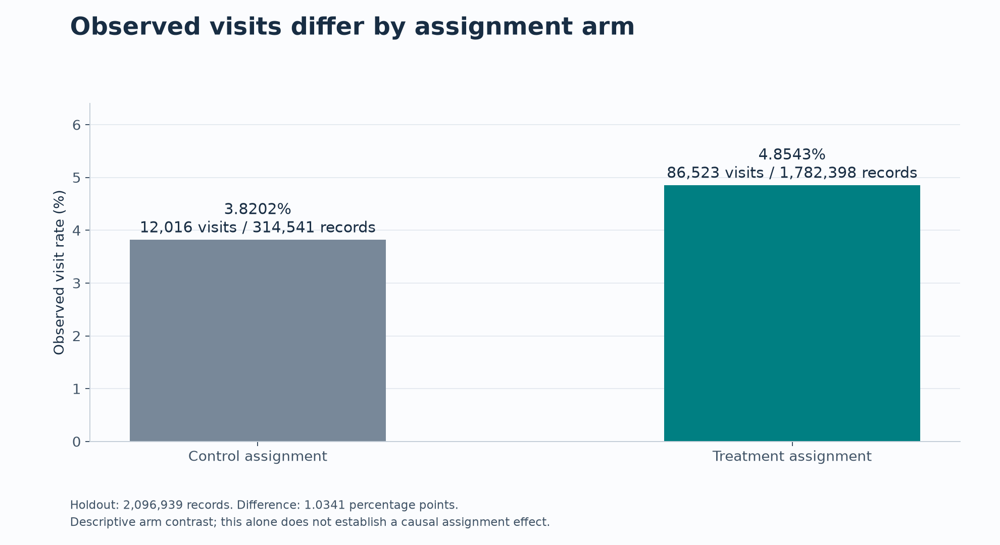
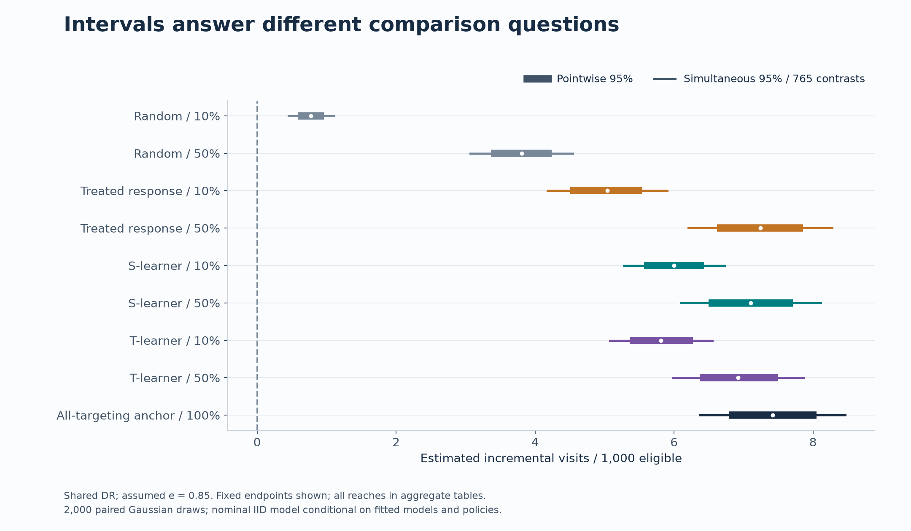

# Final evaluation: aggregate results and figure guide

**Local review only; publication awaits owner approval.** This directory contains
only selected, allowlisted fields from the completed one-time evaluation. It does
not contain row-level outcomes, predictions, fitted models or private checkpoint data.
The [disclosure review](../../docs/PORTFOLIO_REVIEW.md) describes the exact provenance checks.
The [completion report](completion.md) records actual tests and remaining owner gates.

## Read the results correctly

- Primary recommendation: **no targeting**, zero assignments and hypothetical spend.
  Its zero gain relative to itself is an identity, not a test of ad ineffectiveness
  or a proof of optimality. It cannot be replaced using secondary holdout results.
- Policy gains and differences use **estimated incremental visits per 1,000 eligible
  records**. They are not relative percentage changes or gains per targeted user.
- `e=0.85` is an assumed constant propensity; e=.80/.825/.85/.875/.90 are separate
  sensitivity scenarios, not verified probabilities or a probability distribution.
- Intervals are nominal, conditional working-model intervals from the already
  completed 2,000 paired Gaussian-multiplier draws. Pointwise and simultaneous
  intervals are different; simultaneous bands cover the fixed 765-contrast family.
- The stratified sensitivity fixes observed treatment × visit composition. It
  does not replace IID uncertainty and may give zero conditional variance for
  some anchors without establishing causal certainty.

## Figures

| Figure | What it shows | Necessary qualification |
|---|---|---|
| [Descriptive rates](figures/descriptive_rates.png) | Counts and observed treatment/control visit rates | Descriptive assignment contrast, not a verified causal effect |
| [Policy reach](figures/policy_reach.png) | Shared-DR gains for four rankings, 0–50%; all-targeting anchor | Assumed e=.85; lines join fixed points, not continuous policy estimates |
| [Uncertainty](figures/uncertainty_intervals.png) | Pointwise and simultaneous intervals at fixed endpoints | Endpoints chosen for readability, not by performance; all reaches retained in table |
| [Propensity sensitivity](figures/propensity_sensitivity.png) | IPW versus shared/final-S DR all-targeting estimates | Assumptions e=.80–.90; stable DR does not verify identification |
| [S versus T](figures/s_vs_t.png) | Saved paired differences and intervals under IPW/shared DR | All ten simultaneous reference comparisons include zero; no equivalence claim |
| [Architecture](figures/architecture.png) | Completed workflow and aggregate presentation boundary | Historical process, not instructions to run Stage B again |

Every figure also has an editable, standalone SVG beside its PNG. See
[Mermaid workflow](../../docs/ARCHITECTURE.md) for a text diagram. SVGs have no
embedded scripts, private file links or underlying row-level data.





## Reference shared-DR estimates

Assumed e=.85; units are visits/1,000 eligible; brackets are simultaneous 95%
intervals across the entire 765-comparison family under the IID working model.
These are secondary diagnostics, not selected policies.

| Reach | Random | Treated response | S-learner | T-learner |
|---|---|---|---|---|
| 10% | 0.774 [0.448, 1.101] | 5.040 [4.175, 5.904] | 6.002 [5.279, 6.725] | 5.812 [5.074, 6.551] |
| 20% | 1.524 [1.060, 1.989] | 6.677 [5.697, 7.657] | 6.690 [5.785, 7.595] | 6.629 [5.758, 7.500] |
| 30% | 2.264 [1.695, 2.833] | 7.037 [6.023, 8.050] | 6.958 [5.989, 7.927] | 6.759 [5.848, 7.670] |
| 40% | 3.138 [2.480, 3.795] | 7.160 [6.132, 8.187] | 7.010 [6.013, 8.007] | 6.846 [5.920, 7.772] |
| 50% | 3.805 [3.069, 4.541] | 7.241 [6.205, 8.276] | 7.104 [6.095, 8.114] | 6.924 [5.988, 7.860] |

No-targeting minus itself is exactly zero; its absolute visit value need not be
zero. All-targeting is 7.419 [6.376, 8.462] and uses a different assignment budget.

## Complete numerical evidence

[diagnostic_comparisons.csv](figures/diagnostic_comparisons.csv) contains all **1,530
rows**: 765 predeclared contrasts × IID and stratified uncertainty. Fields include
the evaluator, assumed propensity, contrast label, estimate, standard error,
pointwise interval and simultaneous interval. Nothing is filtered by significance.

There are 15 evaluator/scenario combinations (IPW, shared DR and final-S DR × five
assumed propensities). Each has 20 fixed-reach policy-versus-none comparisons,
30 equal-reach pairwise policy differences, and one all-targeting comparison.
Saved labels use `s_learner_minus_t_learner`; the S/T figure reverses the sign and
swaps/negates interval endpoints to display T minus S. `:1` through `:5` denote
10% through 50% reach, respectively.

The original final result manifest SHA-256 is
`447eaa876994dbf77f141d956e80881b96892778943bb72bbcef5a7a554c0ac2`.
The presentation snapshot SHA-256 is
`358c331d72df76d0ca1e4fddd36c7c35be32b1a0b2dd0ae12949c5967ac46169`.
These hashes identify different artifacts; no archive or payload is substituted.

## Reproduction

From the repository root, use the unchanged locked environment:

```sh
make portfolio
```

Or render a separate preview directory:

```sh
uv run --locked python -m portfolio --output /tmp/uplift-portfolio-preview
```

`figure_manifest.json` records output SHA-256 hashes and the plotting version.
The command validates the snapshot checksum and schema before rendering and
never imports the coordinator, statistical evaluator, model fitting or data-access
modules. It copies saved interval values; it never resamples or recalculates CIs.
Dataset-derived assets retain [Criteo attribution and CC BY-NC-SA 4.0](LICENSE.md).
